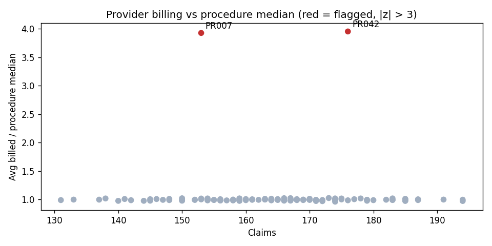

# Synthetic Healthcare Claims: ETL, Validation & Analysis

A portfolio project by **Mahesh M**: a small Python pipeline that generates synthetic healthcare claims, validates and cleans them, and produces summary tables, anomaly flags and charts.

> **Demo project.** All data is synthetic and randomly generated (fixed seed). No real patient, payer or provider data is used, and nothing here comes from or describes any employer's systems. Figures in this README come from the synthetic data and are not real-world metrics.

## Pipeline

```
generate_claims.py  ->  clean_validate.py  ->  analyze.py
 20k synthetic          rule-based checks,     aggregates, provider
 claims + injected      dedupe, reject file,   anomaly flags, charts
 defects                validation report
```

1. **Generate** (`src/generate_claims.py`): ~20,000 claims across 8 procedure codes, 4 payers and ~120 providers, with defects injected on purpose: duplicate rows, invalid procedure codes, missing or negative billed amounts, paid claims with no paid date, payment dates before service dates, paid amount above allowed amount, messy payer labels (`" payer a "`), and two providers who bill about 4x their peers.
2. **Clean and validate** (`src/clean_validate.py`): normalises dates and payer labels, removes exact duplicates and repeated claim IDs, applies six validation rules, writes rejected rows with the reason(s), and returns a validation report.
3. **Analyze** (`src/analyze.py`): payer, procedure and monthly summaries, plus provider-level anomaly detection (z-score of each provider's billed amount relative to the procedure median, minimum 30 claims, flag at |z| > 3).

## Run it

```bash
pip install -r requirements.txt
python run_pipeline.py
python -m unittest discover -s tests -t .     # unit tests for the cleaning rules
```

Outputs land in `output/`:

| File | Contents |
|---|---|
| `validation_report.json` | Row counts per rule |
| `rejected_claims.csv` | Rejected rows plus `reject_reasons` |
| `summary_by_payer.csv` | Claims, denial rate, billed, paid, average days to pay |
| `summary_by_procedure.csv` | Claims, average billed and paid per code |
| `summary_by_month.csv` | Monthly claim volume and billed total |
| `flagged_providers.csv` | Providers flagged as billing outliers |
| `claims_per_month.png`, `provider_anomalies.png` | Charts |

## Sample result (seed 7)

Validation report from the last run:

```json
{
  "rows_in": 20150,
  "exact_duplicates_removed": 141,
  "duplicate_claim_ids_removed": 9,
  "invalid_procedure_code": 120,
  "missing_billed_amount": 98,
  "non_positive_billed_amount": 59,
  "paid_without_paid_date": 68,
  "paid_before_service": 60,
  "paid_exceeds_allowed": 40,
  "rows_rejected": 443,
  "rows_clean": 19557
}
```

The anomaly step flags exactly the two providers that were seeded as outliers (`PR007`, `PR042`):



Note that rule counts can overlap (one row can break several rules), and a few injected defects land on rows that were also deduplicated, so rule counts do not sum exactly to the injected totals.

## Limitations and next steps

- Synthetic data is far cleaner and more uniform than real claims, so the anomaly step is a demonstration of the method, not a tuned detector.
- Procedure code validation uses a small hard-coded list. A real pipeline would reference a maintained code set.
- Next steps: load to a database (SQLite/Postgres), add a data-quality dashboard in Power BI or Tableau, and a robust (median/MAD) outlier method.

## Layout

```
run_pipeline.py       entry point
src/                  generate_claims.py, clean_validate.py, analyze.py
tests/test_clean.py   unit tests
output/               sample results from a run
```

---
Author: Mahesh M. Released under the MIT License.
